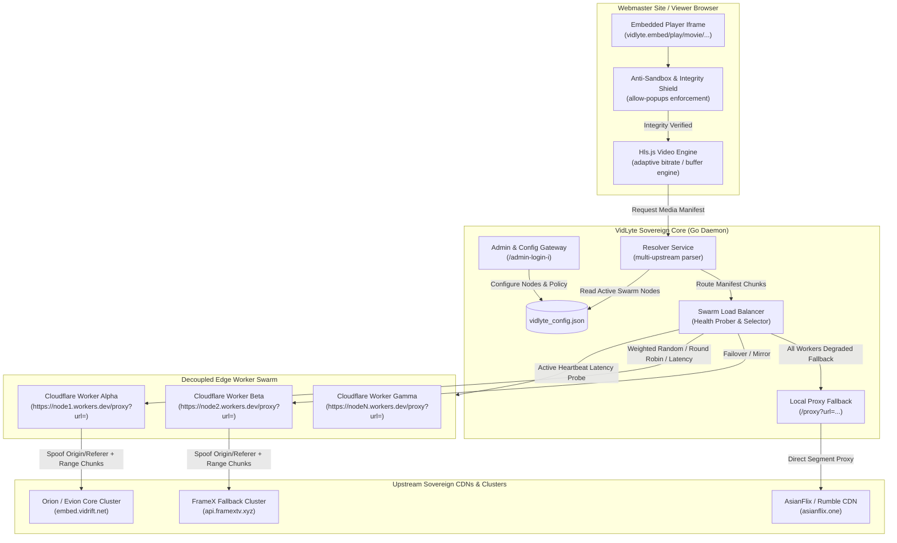

# VidLyte Proxy Swarm & Player Security Architecture

> **High-Availability Edge Stream Proxy Swarm, Zero-Downtime Failover, Dynamic Header Spoofing, and Anti-Circumvention Sandbox Enforcement**

---

## 1. System Topology & Architecture Diagram



---

## 2. Textual / ASCII Flow Representation

```
+---------------------------------------------------------------------------------------------------+
|                                      VIEWER EMBED ENVIRONMENT                                    |
|                                                                                                   |
|  [ Third-Party Webmaster Host ]                                                                   |
|         │                                                                                         |
|         ▼ (iframe embed: allow-scripts allow-same-origin allow-popups allow-forms)               |
|  ┌─────────────────────────────────────────────────────────────────────────────────────────────┐  |
|  │  VidLyte HTML5 Player Container (localhost:6789 / player.vidlyte.net)                        │  |
|  │  ┌───────────────────────────────────────────────────────────────────────────────────────┐  │  |
|  │  │ Anti-Sandbox Shield: Checks window.open capability & sandbox restriction attributes  │  │  |
|  │  │   ├── Restricted sandbox detected? ──► Video halted + Displays Enforcement Shield     │  │  |
|  │  │   └── Verified? ──► Initializes Hls.js + Inlines Server Brand Aliases ("Server 1")    │  │  |
|  │  └───────────────────────────────────────────────────────────────────────────────────────┘  │  |
+──┼────────────────────────────────────────────────────────────────────────────────────────────────┼
   │
   │ 1. GET /api/stream/{type}/{id}
   ▼
+---------------------------------------------------------------------------------------------------+
|                                  VIDLYTE RESOLVER CORE (GO DAEMON)                                |
|                                                                                                   |
|  ┌─────────────────────────┐         ┌─────────────────────────────────────────────────────────┐  |
|  │ Upstream Content Engine │ ──────► │ Swarm Load Balancer (internal/proxy/swarm.go)          │  |
|  │  (Orion / FrameX / etc) │         │  - Thread-Safe Sync Mutex                              │  |
|  └─────────────────────────┘         │  - Strategies: Weighted Random | Round-Robin | Latency │  |
|                                      │  - Active Health Telemetry Probe (/admin/api/swarm/test) │  |
|                                      └────────────────────────────┬────────────────────────────┘  |
+───────────────────────────────────────────────────────────────────┼───────────────────────────────+
                                                                    │
                    ┌───────────────────────────────────────────────┴──────────────────────────────┐
                    │                                                                              │
                    ▼ Strategy = "random" / "round_robin"                                          ▼ All Nodes Down?
+-------------------------------------------------------------+              +----------------------------------+
|               CLOUDFLARE EDGE WORKER SWARM                  |              |       LOCAL GO PROXY ENGINE      |
|                                                             |              |                                  |
|   ┌───────────────────────┐     ┌───────────────────────┐   |              |  GET /proxy?url=<target>&...     |
|   │ Worker Node 1 (Alpha) │     │ Worker Node 2 (Beta)  │   |              |  - Local Go streaming relay      |
|   │ ...workers.dev/proxy  │     │ ...workers.dev/proxy  │   |              |  - Header rewrite & spoofing     |
|   └───────────┬───────────┘     └───────────┬───────────┘   |              +──────────────────┬───────────────+
+───────────────┼─────────────────────────────┼───────────────+                                 │
                │                             │                                                 │
                │ (Origin: embed.vidrift.net) │ (Range: bytes=0-1048576)                        │
                ▼                             ▼                                                 ▼
+───────────────────────────────────────────────────────────────────────────────────────────────────+
|                                    UPSTREAM CDN & HLS CLUSTERS                                    |
|                                                                                                   |
|   [ Orion HLS Origin ]             [ FrameX API Origin ]            [ AsianFlix / Rumble CDN ]   |
|     (embed.vidrift.net)               (api.framextv.xyz)                 (asianflix.one)          |
+---------------------------------------------------------------------------------------------------+
```

---

## 3. High-Performance Load Balancing Strategies

The `SwarmBalancer` engine (`internal/proxy/swarm.go`) supports 4 distinct routing algorithms:

### 1. Weighted Random Dispersion (`random` - Default & Recommended)
- Each registered worker node is assigned an integer weight (default: 1).
- The balancer calculates total cumulative weight and performs an integer boundary selection.
- **Benefit**: Statistically optimal for thousands of concurrent streaming connections. Prevents stampedes and hot-spotting on any single worker account or IP.

### 2. Strict Round-Robin Distribution (`round_robin`)
- An atomic counter increments per manifest segment and cycles through the list of active, healthy workers modulo $N$.
- **Benefit**: Guarantees exactly equal traffic allocation across multiple free-tier Cloudflare accounts (e.g. 100,000 requests/day per worker).

### 3. Telemetry-Driven Lowest Latency (`latency`)
- Background health probes measure round-trip HTTP handshake and response times for each edge node.
- The balancer routes chunks to the edge node reporting the lowest ping in milliseconds.
- **Benefit**: Ensures the lowest time-to-first-byte (TTFB) for users in varied geographical regions.

### 4. Zero-Downtime Local Fallback (`fallback_local`)
- If the entire swarm is disabled or all workers return connectivity errors, requests dynamically degrade to the internal Go server proxy (`/proxy?url=...`). Video playback never breaks.

---

## 4. Anti-Sandbox & Circumvention Security Shield

Malicious webmasters often attempt to scrape streams or suppress platform monetization by embedding the player inside restrictive sandboxes:
```html
<!-- Bypassing ad monetization attempt -->
<iframe src="https://player.vidlyte.net/..." sandbox="allow-scripts"></iframe>
```

### Protection Mechanisms Implemented in `player.html`:

1. **Permission Audit on Boot**:
   Synchronously evaluates whether the host iframe grants required privileges:
   - `allow-scripts`
   - `allow-same-origin`
   - `allow-popups`
   - `allow-popups-to-escape-sandbox`

2. **Synchronous Window.Open Probe**:
   When a user clicks play, the monetization dispatcher calls `window.open("about:blank", "_blank")`.
   - If the browser blocks the window creation due to sandbox constraints (throwing `DOMException` or returning `null`), the engine halts video playback instantly.

3. **Tamper-Proof Glassmorphism Enforcement Shield**:
   - The `#securityShield` overlay is brought to `z-index: 999999` with pointer events locked.
   - It cannot be dismissed or closed.
   - Clear diagnostic reason is rendered (e.g., `MISSING_ALLOW_POPUPS` or `IFRAME_RESTRICTIVE_SANDBOX`).
   - Copy-paste compliant iframe snippet is provided to the webmaster.

---

## 5. Server Masking & Custom Branding

Webmasters and viewers interact with clean, professional server labels configurable in the Admin Panel:

| Internal Core ID | Default Cluster Name | Admin Custom Alias Example | Player Pill Output |
| :--- | :--- | :--- | :--- |
| `orion` | Orion / Evion Core | `Server 1 (Ultra Fast)` | `1080P · SERVER 1 (ULTRA FAST)` |
| `framex` | FrameX TV Backup | `Server 2 (Backup)` | `1080P · SERVER 2 (BACKUP)` |
| `asianflix` | AsianFlix / Rumble CDN | `Server 3 (Anime / Asian)` | `720P · SERVER 3 (ANIME)` |

When **Display Server Names in Player Controls** is toggled off:
- The server name is completely stripped from the player UI.
- The pill renders cleanly as `1080P` or `720P`.
- Audio tracks clean server references (e.g., `"English [Orion]"` becomes `"English"`).

---

## 6. Cloudflare Worker Deployment Guide

### Deploying a Worker Node in 30 Seconds:
1. Log in to [Cloudflare Dashboard](https://dash.cloudflare.com/) and navigate to **Workers & Pages**.
2. Click **Create Application** -> **Create Worker**.
3. Name your worker (e.g. `vidlyte-swarm-01`).
4. Click **Deploy**, then click **Edit code**.
5. Paste the contents of `data/cloudflare_worker_template.js`.
6. Click **Save and Deploy**.
7. Copy your worker domain: `https://vidlyte-swarm-01.<your-subdomain>.workers.dev`
8. In VidLyte Admin Panel (`/admin-login-i` -> **Proxy Swarm**), paste:
   ```
   https://vidlyte-swarm-01.<your-subdomain>.workers.dev/proxy?url=
   ```
   *(Note: If you enter only the base URL, VidLyte automatically normalizes it).*
9. Click **Probe All Nodes** to verify instantaneous connectivity and latency.
