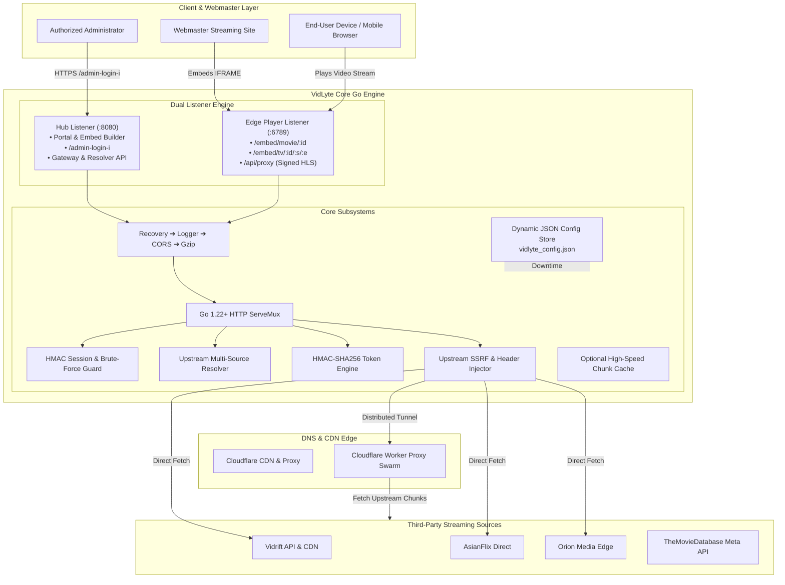
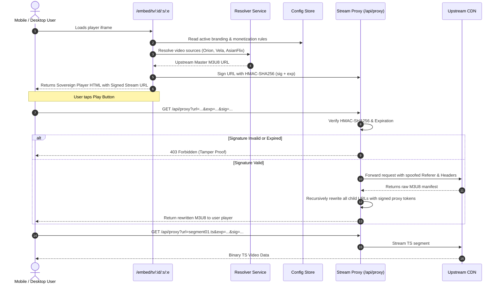

# VidLyte System Architecture

VidLyte is a zero-external-dependency, high-throughput HLS streaming gateway, media resolver, and modern embed player designed for webmasters and streaming networks. Built with Go 1.22+ and vanilla web technologies, the entire system operates with microsecond-level overhead, sub-millisecond route dispatch, and zero third-party package dependencies.

---

## 1. High-Level Architectural Overview

VidLyte employs a decoupled multi-listener topology that separates the public webmaster portal and administrative command hub from the public-facing video player edge.

---

## 2. Core Architectural Pillars

### A. Zero-Dependency Go Standard Library Standard
VidLyte uses purely Go standard library packages (`net/http`, `crypto/hmac`, `crypto/sha256`, `encoding/json`, `sync`, `time`, `os`). This ensures:
- **Zero Supply-Chain Risk**: Immune to malicious upstream npm/Go module vulnerabilities.
- **Microsecond Cold-Starts**: Single binary footprint under 14 MB that boots instantaneously on bare-metal, Docker, Render, or Koyeb.
- **Ultra-Low Memory Footprint**: Operates comfortably in resource-constrained environments (128 MB RAM).

### B. Dual-Listener Decoupled Topology
1. **Master Core Hub (`:8080`)**:
   - Hosts the VidLyte Webmaster Portal (`/`) and dynamic live player sandbox.
   - Hosts the hidden administrative control center (`/admin-login-i`).
   - Hosts the REST API and HLS session gateway (`/v1/playback-sessions`, `/hls/...`).
2. **Edge Player Listener (`:6789`)**:
   - Dedicated exclusively to serving iframe players (`/embed/...`) and streaming proxied video chunks (`/api/proxy`).
   - Can be bound to distinct public domain names or isolated edge servers, ensuring traffic spikes on the player do not impact administration or source resolution.
   - Can run unified on a single port (`PORT=8080`, `PLAYER_PORT=none`) for single-port cloud hosts like Render and Koyeb.

### C. Zero-Downtime Dynamic Configuration (`vidlyte_config.json`)
Operational parameters can be tuned in real time via the Admin Control Room without restarting the server:
- Brand styling, logos, and accent colors.
- Server display names and priority ordering (Orion, Vela, Atlas, Titan, Lyra).
- Cloudflare Worker proxy swarm endpoints with live latency testing.
- Adsterra popunder monetization keys, frequencies, and target domains.
- Anti-Adblock detection enforcement policies and custom visitor prompts.

The configuration store uses atomic file writes (`sync.RWMutex` + atomic rename) to guarantee zero corruption and zero race conditions under high concurrent read traffic.

---

## 3. Request Lifecycle

---

## 4. Subsystem Breakdown

| Subsystem | Location | Functionality |
| :--- | :--- | :--- |
| **Admin Operations** | [`internal/admin/`](file:///d:/@1/byse-norm/internal/admin/) | Secret authentication, lockout protection, proxy swarm health checks, dynamic config API. |
| **Dynamic Config** | [`internal/config/`](file:///d:/@1/byse-norm/internal/config/) | File-backed JSON store with thread-safe atomic memory synchronization. |
| **Embed Player** | [`internal/embed/`](file:///d:/@1/byse-norm/internal/embed/) | Glassmorphic video player UI, mobile bottom sheet, Web Audio API booster, anti-adblock detection engine. |
| **HLS Stream Proxy** | [`internal/proxy/`](file:///d:/@1/byse-norm/internal/proxy/) | HMAC-SHA256 stream token verification, recursive manifest rewriting, and worker load balancing. |
| **Multi-Source Resolver**| [`internal/service/`](file:///d:/@1/byse-norm/internal/service/) | Multi-tier source resolution (Vidrift, AsianFlix, FrameX) with automatic fallback. |
| **Gateway & Cache** | [`internal/gateway/`](file:///d:/@1/byse-norm/internal/gateway/) | Session-based HLS distributor with LRU memory and disk chunk caching. |
| **Distributed Swarm & Cache** | [`docs/DISTRIBUTED_SWARM_AND_CACHE.md`](file:///d:/@1/byse-norm/docs/DISTRIBUTED_SWARM_AND_CACHE.md) | Decentralized L1 RAM + L2 Upstash Redis Swarm + L3 Cloudflare Edge Worker CDN Swarm. |
| **Public Portal** | [`internal/portal/`](file:///d:/@1/byse-norm/internal/portal/) | Webmaster homepage, embed code generator, live preview builder, documentation. |
