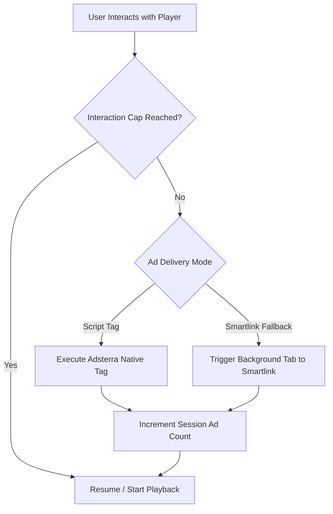

# VidLyte Monetization & Anti-Adblock Engine

VidLyte provides a high-yield monetization suite built directly into the video player. It pairs Adsterra popunder and smartlink advertising with a multi-vector anti-adblock detection shield that defeats new-age ad blockers and browser-native blockers like Brave Shields.

---

## 1. Monetization Architecture

VidLyte natively supports two primary monetization formats:
1. **Direct Script Popunder**: Asynchronous JavaScript tag injection (e.g., Adsterra script tag `//pl123456.highratecpm.com/...`).
2. **Fallback Smartlink Popunder**: Pure JavaScript click-listener that dispatches the visitor to a high-CPM direct smartlink on first user interaction (touch/click).



### Configurable Controls in Admin Control Room
Through `/admin-login-i`, administrators can configure monetization in real time:
- **Enable / Disable Toggle**: Instantly shut off or activate ads globally.
- **Provider Selection**: `Adsterra Script Tag` or `Custom Direct Smartlink`.
- **Target URL / Script Key**: Paste script source or direct smartlink URL.
- **Frequency Capping**: Number of popunder triggers allowed per session (e.g. 1 to 3 clicks).
- **Domain Restriction**: Restrict popunder firing to specific player domain origins.

---

## 2. Multi-Vector Anti-Adblock Detection Engine

Modern visitors utilize a wide variety of ad-blocking technologies:
- **Brave Browser Native Shields**: Rust-based engine built directly into Chromium that blocks network requests and strips DOM elements before JavaScript runs.
- **uBlock Origin & AdBlock Plus**: Extension-based cosmetic filters, element hiding, and request interception.
- **AdGuard & Opera Blocker**: DNS-level and rule-based filter lists (`EasyList`, `Peter Lowe's List`).
- **Private DNS & Pi-hole**: Hardware and OS-level DNS sinks.

VidLyte employs an asynchronous multi-vector detection matrix executed as soon as the player initializes.

### Vector 1: Brave Native Shield Detection
Brave implements a vendor-specific browser API method `navigator.brave.isBrave()`. VidLyte invokes this probe asynchronously:
```javascript
if (navigator.brave && typeof navigator.brave.isBrave === 'function') {
    navigator.brave.isBrave().then(function(isBrave) {
        if (isBrave) {
            // Brave browser detected. Check if shields are actively suppressing requests.
            testNetworkCanary();
        }
    });
}
```

### Vector 2: Cosmetic DOM Bait Injection
Ad blockers use cosmetic rules to inject `display: none !important;` on elements matching advertising class signatures. VidLyte mounts an invisible canary bait element:
```html
<div id="ad-banner-tester" class="ad-banner adsbox pub_300x250 text-ad" 
     style="position:absolute;left:-9999px;top:-9999px;width:1px;height:1px;">&nbsp;</div>
```
The player then checks computed layout properties:
```javascript
var bait = document.getElementById('ad-banner-tester');
if (!bait || bait.offsetParent === null || bait.offsetHeight === 0 || 
    window.getComputedStyle(bait).display === 'none') {
    triggerAdblockDetected();
}
```

### Vector 3: Network Canary Probe
Ad blockers intercept HTTP requests matching known ad server patterns. VidLyte dispatches a non-blocking `fetch` request against a universal ad endpoint canary:
```javascript
fetch('https://pagead2.googlesyndication.com/pagead/js/adsbygoogle.js', {
    method: 'HEAD',
    mode: 'no-cors',
    cache: 'no-store'
}).catch(function() {
    // Network fetch was aborted or intercepted by ad blocker
    triggerAdblockDetected();
});
```

### Vector 4: Global Variable & Adsterra Script Verification
When Adsterra script mode is enabled, the player verifies whether the provider's global object has been populated or if the script element was prevented from loading:
```javascript
var script = document.querySelector('script[src*="highratecpm"], script[src*="alwingulla"]');
if (script && script.onerror === null) {
    script.onerror = function() {
        triggerAdblockDetected();
    };
}
```

---

## 3. Enforcement & Player Overlay

When an ad blocker or Brave Shield is detected:
1. **Playback Interruption**: If the video is currently playing, it is immediately paused.
2. **Unclosable Shield**: The `#adblockShield` glassmorphic modal covers the entire player viewport.
3. **Custom Message**: Displays the administrator's configured message (e.g. *"Ad blocker detected. Please disable your ad blocker or turn off Brave Shields to continue watching."*).
4. **Re-check & Continue**: A prominent button allows visitors to re-evaluate after toggling off their blocker without needing to refresh the page.

---

## 4. Admin Configuration Reference

In `internal/config/store.go` and `data/vidlyte_config.json`:

```json
{
  "monetization": {
    "enabled": true,
    "provider": "adsterra",
    "adsterra_tag": "//pl12345678.highratecpm.com/a1/b2/c3.js",
    "smartlink_url": "https://example-smartlink.com/track",
    "popunder_frequency": 2,
    "anti_adblock_enabled": true,
    "anti_adblock_strict_brave": true,
    "anti_adblock_message": "Ad blocker detected. Please disable your ad blocker or Brave Shields to continue watching."
  }
}
```
All settings can be changed in real time from `/admin-login-i` without server restarts.
